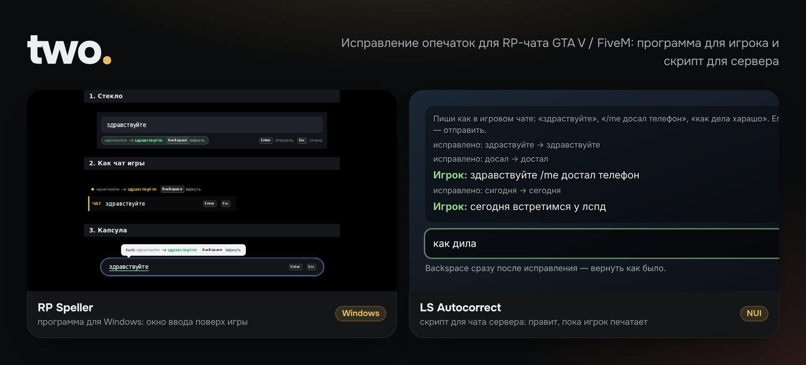
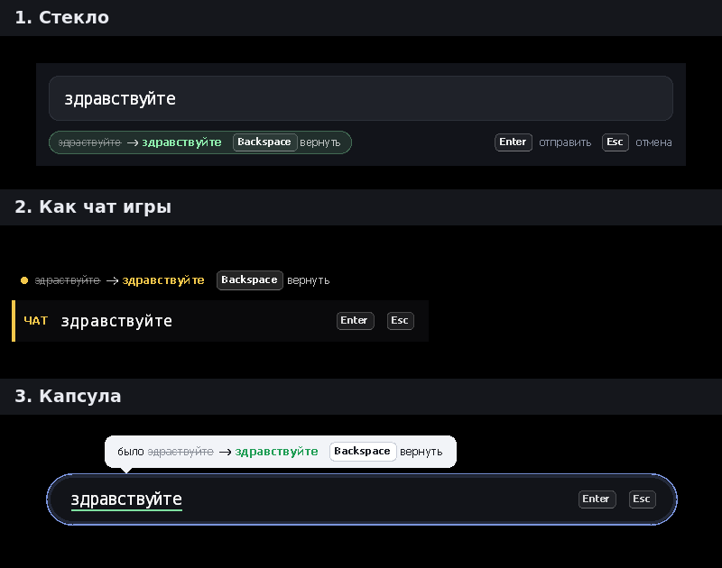
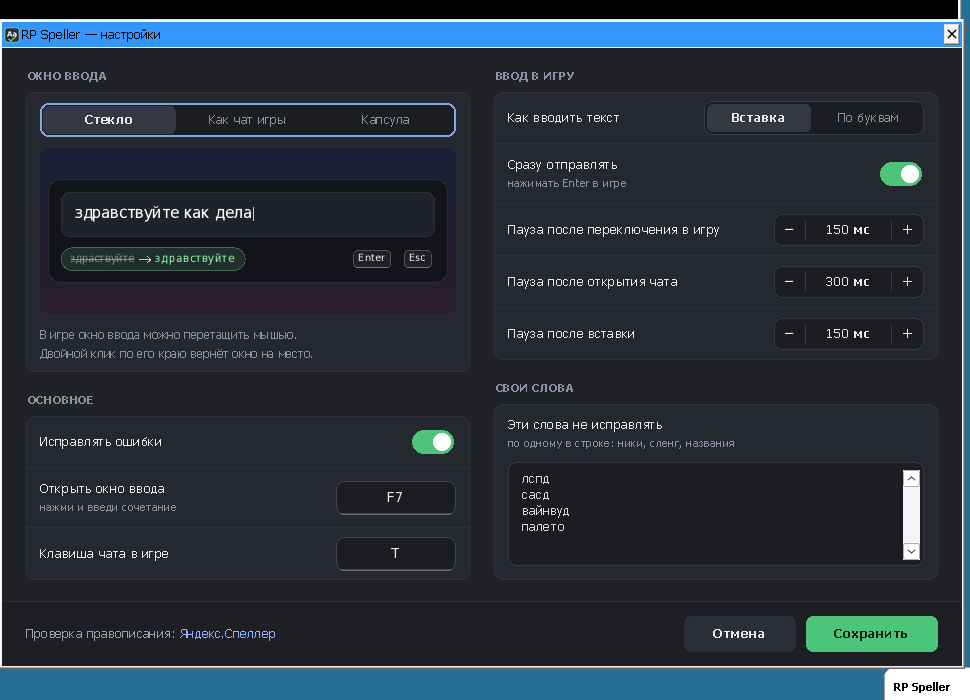
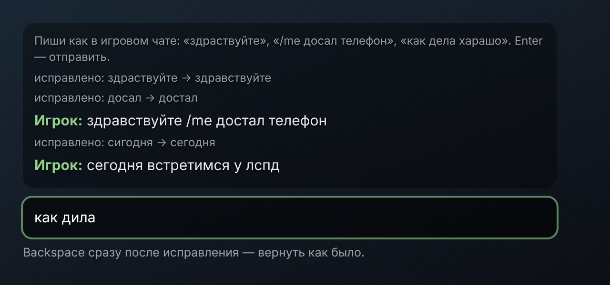

<div align="center">



**Исправление опечаток для RP-чата GTA V / FiveM: программа для игрока и скрипт для сервера.**

[Скачать](#скачать) · [RP Speller](#rp-speller) · [LS Autocorrect](#ls-autocorrect) · [Чем отличаются](#чем-отличаются) · [Структура](#структура)

</div>

## Скачать

Название проекта открывает его страницу: описание, установка, что нового. «⬇ Скачать» сразу скачивает готовый файл.

| Проект | Скачать |
|---|---|
| **[RP Speller](rp-speller/)**<br>Программа для Windows: исправляет опечатки в чате GTA V / FiveM | **[⬇ Скачать](https://github.com/splithillz/two/raw/main/releases/RPSpeller-0.3.0.zip)**<br><sub>zip · 0.3.0 · 0,9 МБ</sub> |
| **[LS Autocorrect](ls-autocorrect/)**<br>Скрипт для чата сервера: исправляет опечатки, пока игрок печатает | **[⬇ Скачать](https://github.com/splithillz/two/raw/main/ls-autocorrect/ls-autocorrect.js)**<br><sub>ls-autocorrect.js · 13 КБ</sub> |

Темы «Кадр» для kinoarc, kinohub и форума LS Project и тема для роутера живут в соседнем репозитории — [**one**](https://github.com/splithillz/one).

## RP Speller

| Три вида окна ввода | Настройки |
|---|---|
|  |  |

Программа для Windows, которая исправляет опечатки в том, что ты пишешь в игровой чат. Игру и сервер не трогает: работает как переводчик RP Chat Overlay — своё окно поверх игры и нажатия клавиш.

- **F7** в игре открывает окно ввода. Ошибки исправляются после пробела, **Enter** вставляет текст в игровой чат и отправляет.
- **Backspace** сразу после исправления возвращает слово, и это слово больше не исправляется. Свои слова — ники, сленг, названия — задаются в настройках.
- Три вида окна ввода: «Стекло», «Как чат игры» и «Капсула».
- Исправления от Яндекс.Спеллера, в сеть уходят отдельные слова, а не сообщения.
- Один `RPSpeller.exe` на 0,7 МБ, написан на Rust. В архиве есть самопроверка для своего компьютера.

[](https://github.com/splithillz/two/raw/main/releases/RPSpeller-0.3.0.zip)
[](rp-speller/)

## LS Autocorrect



Один файл `ls-autocorrect.js` без зависимостей для интерфейса чата на сервере. Исправляет опечатки у игрока, пока он печатает, как клавиатура в телефоне: «здраствуйте» → «здравствуйте».

- Не трогает команды (`/me`, `/do` и любые другие), ID, цифры, латиницу, ссылки, имена с большой буквы и чатовый сленг.
- Backspace сразу после исправления возвращает слово и запоминает его.
- Свои слова сервера добавляются одной строкой.

[](https://github.com/splithillz/two/raw/main/ls-autocorrect/ls-autocorrect.js)
[](ls-autocorrect/)

Демо: [`demo.html`](ls-autocorrect/demo.html) — скачай папку и открой файл в браузере.

## Чем отличаются

| | RP Speller | LS Autocorrect |
|---|---|---|
| Для кого | для игрока | для сервера |
| Где работает | своё окно поверх игры на Windows | внутри чата сервера |
| Что сделать | скачать и запустить `RPSpeller.exe` | подключить `ls-autocorrect.js` к интерфейсу чата |
| Откуда исправления | Яндекс.Спеллер | Яндекс.Спеллер |
| Отмена исправления | Backspace сразу после него | Backspace сразу после него |
| Свои слова | список в настройках программы | список в файле сервера, плюс слова, которые игрок вернул Backspace |

## Структура

```
two/
├── rp-speller/       RP Speller, программа для Windows на Rust
├── ls-autocorrect/   LS Autocorrect, автоисправление для чата сервера
├── releases/         готовый архив RP Speller
└── docs/             картинки для этого README
```

У каждого проекта свой README: что нового, как поставить, что проверено и как собрать.

## Лицензии

- Проекты пока без отдельной лицензии.
- Исправления дают API Яндекс.Спеллера, [условия использования](https://yandex.ru/legal/speller_api/).
